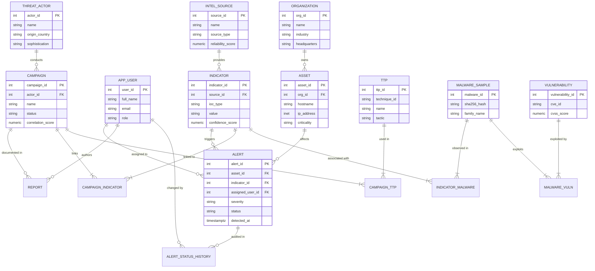

# AI-Driven Cyber Threat Intelligence & Attack Campaign Correlation System

**DBMS mini project — PostgreSQL + MongoDB**

A dual-database project: PostgreSQL stores normalized operational entities and relationships; MongoDB stores flexible threat-evidence documents with nested source context and tags.

## Authors

- Amit — PES2UG24CS624
- M. Sangamesh Prasad — PES2UG24CS640

## Repository contents

```text
.
├── docs/
│   └── project-report.docx
├── evidence/
│   ├── screenshots/       # 31 terminal screenshots, retained from the supplied PDF
│   └── source/            # Original SQL execution report PDF
├── src/
│   ├── server.js           # Local Node.js API and static web server
│   └── public/             # Dashboard HTML, CSS, and browser JavaScript
├── mongodb/
│   └── seed-documents.json # Example flexible evidence documents
├── scripts/
│   └── seed-mongodb.js     # Idempotently loads the MongoDB sample documents
└── sql/
    ├── 00_setup.md
    ├── 01_schema.sql
    ├── 02_seed_data.sql
    ├── 03_views_indexes.sql
    ├── 04_queries.sql
    ├── 05_functions_procedures_triggers.sql
    ├── 06_transaction_examples.sql
    └── recovered-examples.sql
```

## Included SQL

The ordered scripts provide a full reconstructed PostgreSQL implementation: relational schema and constraints, sample inserts, junction-table relations, joins, updates, aggregates, subqueries, `CASE`, a campaign summary view, `EXISTS`/`NOT EXISTS`, indexes, transaction and savepoint examples, a SQL function, a stored procedure, and audit/update triggers. Setup steps and run order are in [`sql/00_setup.md`](sql/00_setup.md).

The supplied source files contained an execution report with screenshots, but not the original complete `.sql` files. The implementation in `sql/` was therefore reconstructed from the project report and visible evidence; it is an integrated runnable version, not a byte-for-byte copy of the unavailable original. Correlation scores use a decimal scale from 0 to 1, matching the values visible in the supplied screenshots. Some seed values are illustrative. The report records what was shown in the supplied evidence; routines and triggers are repository additions beyond that evidence.

## Two databases

- **PostgreSQL (SQL):** normalized organizations, users, threat actors, campaigns, indicators, assets, alerts, and audit records.
- **MongoDB (NoSQL):** flexible documents in `threat_intel_evidence.threat_evidence`, including source-specific nested context and tags. Each document links to its PostgreSQL indicator ID.

The dashboard reads structured views from PostgreSQL and displays evidence documents from MongoDB under **Intel evidence**. Example documents are provided in [`mongodb/seed-documents.json`](mongodb/seed-documents.json).

## Entity-Relationship (ER) Diagram



## AI-Driven Attack Campaign Correlation Engine

The correlation engine quantifies the likelihood and strength of a threat campaign using a multi-factor mathematical scoring model implemented directly as a PostgreSQL stored procedure (`calculate_campaign_correlations()`):

$$\text{Correlation Score} = \min\left(1.000, 0.40 \cdot \overline{C}_{\text{IOC}} + 0.25 \cdot \overline{R}_{\text{Source}} + 0.20 \cdot \frac{\min(N_{\text{TTP}}, 5)}{5} + 0.15 \cdot \frac{\min(N_{\text{Alerts}}, 5)}{5}\right)$$

1. **Indicator Confidence ($\overline{C}_{\text{IOC}}$):** Average normalized confidence of all IOCs tied to the campaign ($0.0 - 1.0$).
2. **Intel Source Reliability ($\overline{R}_{\text{Source}}$):** Trust score of intelligence feeds (OSINT, Commercial, ISAC, Internal).
3. **MITRE ATT&CK Breadth ($N_{\text{TTP}}$):** TTP diversity representing adversary tradecraft sophistication.
4. **Telemetry Verification ($N_{\text{Alerts}}$):** Real-world detection validation on monitored organizational assets.

Analysts can execute the procedure directly in SQL or trigger it on-demand from the web console via the **"⚡ Run AI Correlation Engine"** action.

## Evidence

The [screenshot gallery](evidence/screenshots/README.md) includes all 31 terminal screenshots, each with a heading and an explanation of what it demonstrates. A machine-readable index is also available in `evidence/screenshots/README.csv`. The original execution report is preserved in `evidence/source/`.

## Web dashboard

The repository includes a modern web console featuring:
- **Interactive SOC Dashboard:** Overview, alert queue, campaign links, indicator tracking, and MongoDB flexible intel evidence.
- **Theme Switcher:** Instant toggle between Dark SOC mode (cyberpunk terminal) and Light Mode.
- **Visual Analytics:** SVG alert severity donut chart and live correlation progress bars.
- **Live Trigger Integration:** Status changes immediately record an audit trail in PostgreSQL via the `audit_alert_status_change` trigger.
- **Offline Demo Mode:** Automatic zero-crash demo mode fallback for vivas and presentations when live database daemons are offline.

Install dependencies with `npm install`, configure both databases in `.env`, and follow [`src/README.md`](src/README.md) to initialize and start them.
