# Screenshot Gallery

This gallery documents every terminal screenshot retained from the supplied project execution report. Each caption explains the SQL operation or database result visible in the image. Screenshots are numbered here for navigation; the number is not the figure number from the source PDF.

## Core records and schema

### Screenshot 01 — User records

Shows the inserted analysts and account fields returned from the user table.

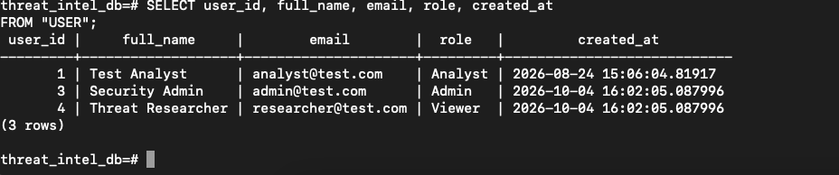

### Screenshot 02 — Organizational assets

Lists asset IDs, organization links, hostnames, IP addresses, and criticality.

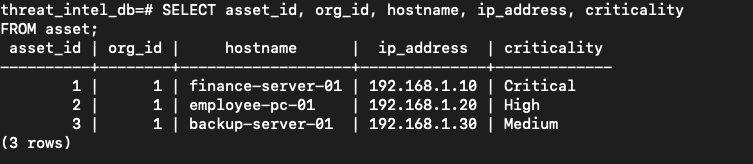

### Screenshot 03 — Threat actor records

Shows the threat actor rows and attributes such as aliases, origin country, and sophistication.

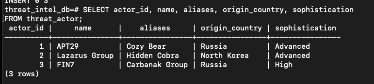

### Screenshot 04 — Combined psql session and schema inspection

A broader terminal capture with base-data commands and the intel_source table definition, including its columns and constraints.

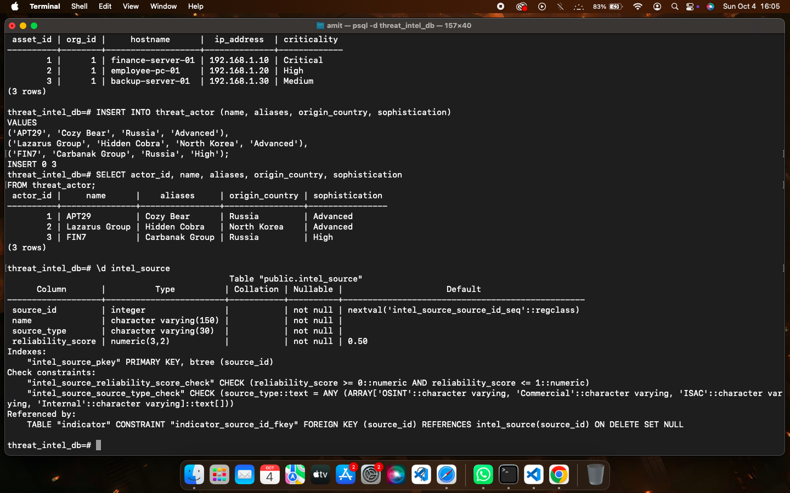

### Screenshot 05 — Intelligence source records

Lists intelligence feeds, source types, and reliability scores.

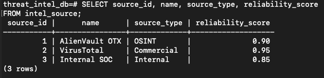

### Screenshot 06 — Indicators of compromise (IOCs)

Shows IOC types and values together with source, confidence, and observed dates.

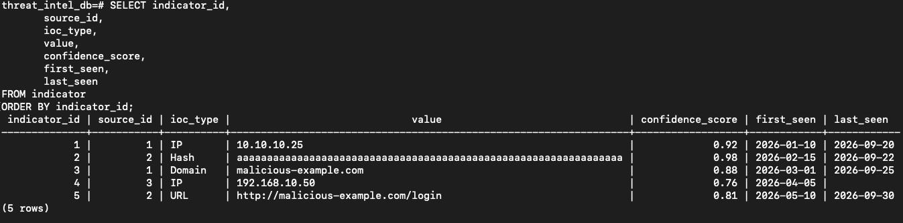

### Screenshot 07 — Attack campaign records

Lists campaigns, their associated actors, objectives, dates, and statuses.

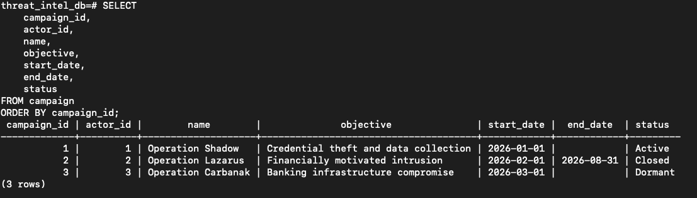

### Screenshot 08 — MITRE ATT&CK techniques (TTPs)

Shows technique IDs, tactics, and technique names.

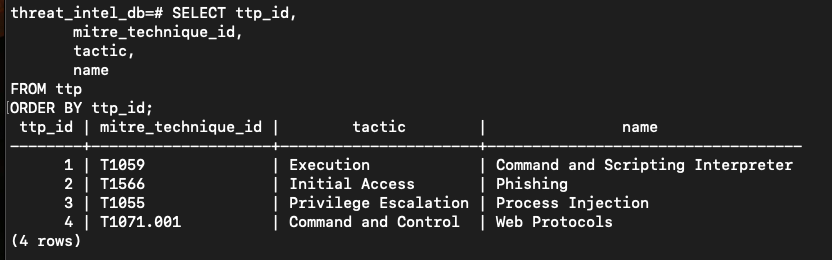

### Screenshot 09 — Malware sample records

Lists malware hashes, family names, file types, and first-seen dates.

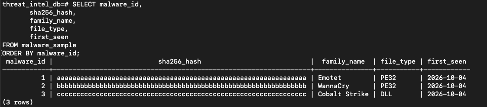

### Screenshot 10 — Malware and vulnerability join

Connects malware samples to CVEs and returns vulnerability scores and descriptions.

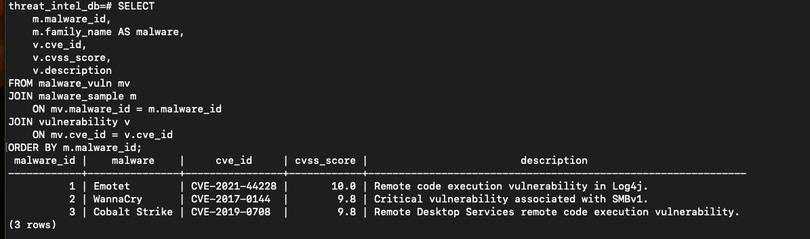

## Relationship queries

### Screenshot 11 — Campaign and indicator join

Lists indicators associated with each campaign, including confidence and correlation values.

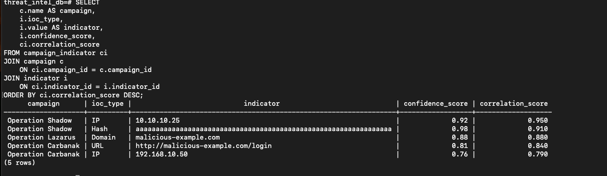

### Screenshot 12 — Campaign and TTP join

Shows the techniques linked to each campaign and the corresponding tactics.

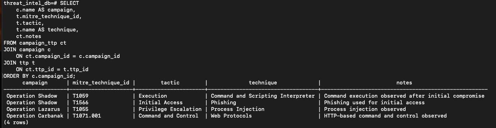

### Screenshot 13 — Indicator and malware join

Connects IOC records to malware families and file types.

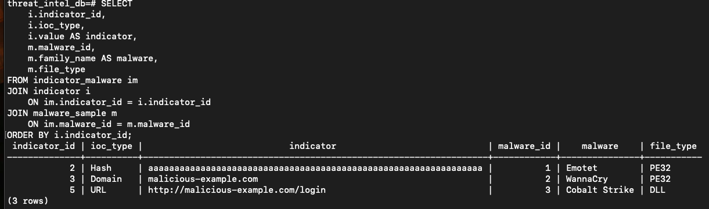

### Screenshot 14 — Alert, asset, indicator, and analyst join

Combines alert severity and status with affected host, matched IOC, and assigned analyst.

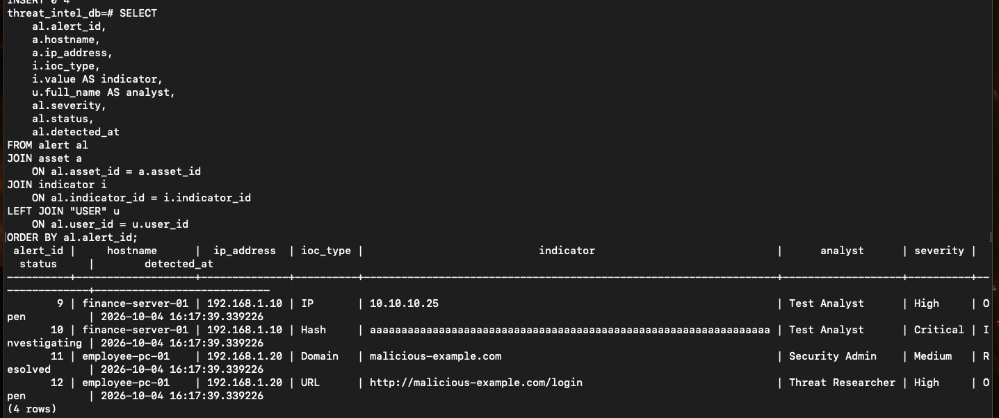

### Screenshot 15 — Report, author, and campaign join

Lists reports with their author, campaign, classification, and publication date.

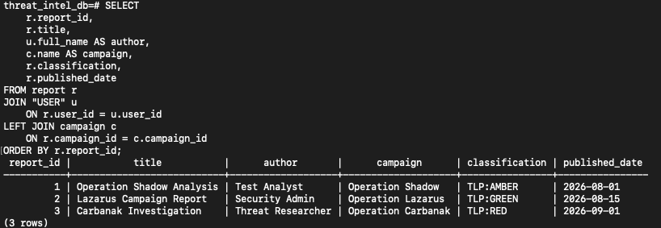

## Updates and analytical queries

### Screenshot 16 — Alert status update

Updates an alert to Investigating and queries the row to confirm the new status.

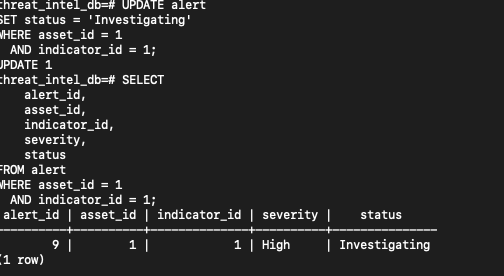

### Screenshot 17 — Alert count by severity

Uses GROUP BY and COUNT to summarize alerts in each severity category.

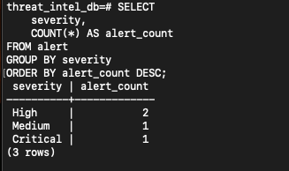

### Screenshot 18 — Campaign count with HAVING

Groups indicators by campaign and filters the groups with a HAVING condition.

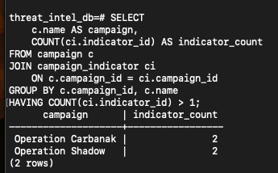

### Screenshot 19 — Average indicator confidence by IOC type

Uses AVG with GROUP BY to compare confidence across IOC types.

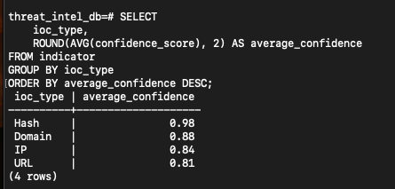

## Advanced SQL

### Screenshot 20 — Indicators above average confidence

Uses a nested subquery to return indicators whose confidence exceeds the overall average.

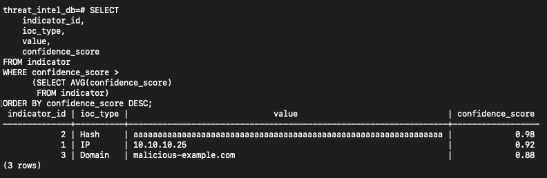

### Screenshot 21 — Campaigns above their actor’s average correlation

Uses a correlated subquery to compare each campaign with the average score for its threat actor.

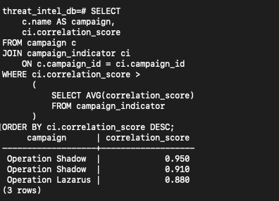

### Screenshot 22 — CASE-based alert priority

Maps alert severities to human-readable priority labels with a CASE expression.

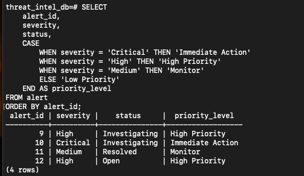

### Screenshot 23 — Campaign threat summary view

Queries the view that summarizes campaign, actor, indicator, and correlation information.

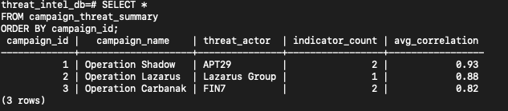

### Screenshot 24 — EXISTS: campaigns with indicators

Returns campaigns for which at least one linked indicator exists.

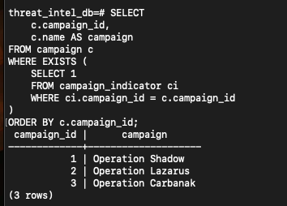

### Screenshot 25 — NOT EXISTS: assets without resolved alerts

Finds assets with no associated alert marked Resolved.

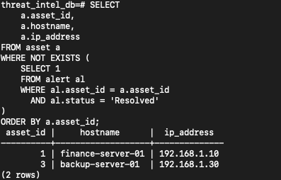

## Transactions and indexes

### Screenshot 26 — Savepoint and commit

Demonstrates a transaction with a savepoint, a rollback to that savepoint, and a final commit.

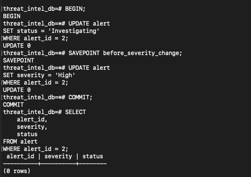

### Screenshot 27 — Full transaction rollback

Demonstrates rolling back a transaction so the change is discarded.

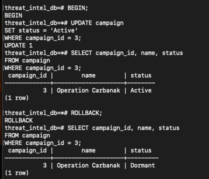

### Screenshot 28 — Database index listing

Shows the indexes present in the PostgreSQL database and the relations they support.

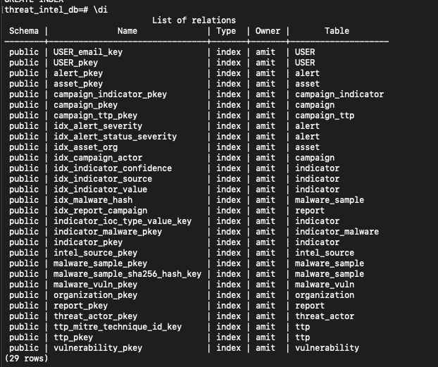

## Final security analysis

### Screenshot 29 — High and critical security alerts

Filters alerts to high-severity and critical-severity records.

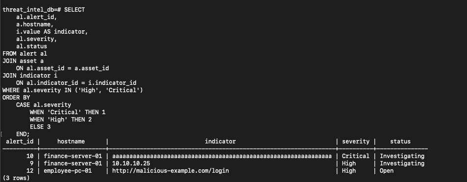

### Screenshot 30 — Strong campaign correlations

Returns campaigns above the selected correlation threshold, ordered by score.

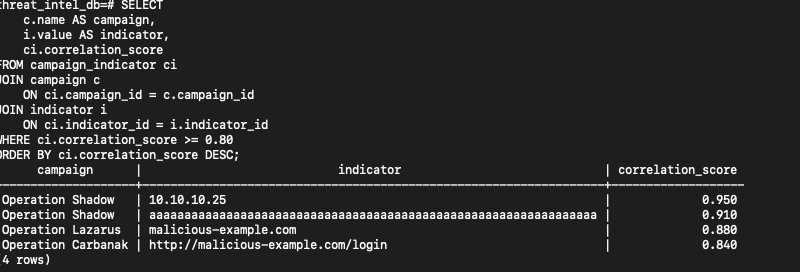

### Screenshot 31 — Final threat intelligence correlation query

Combines campaign, actor, indicator, malware, alert, and asset data for investigation.

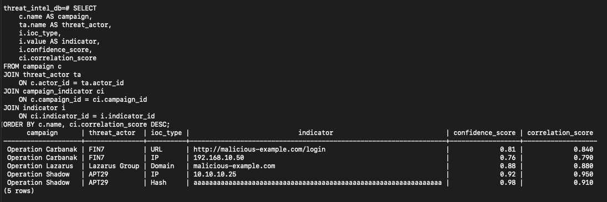
